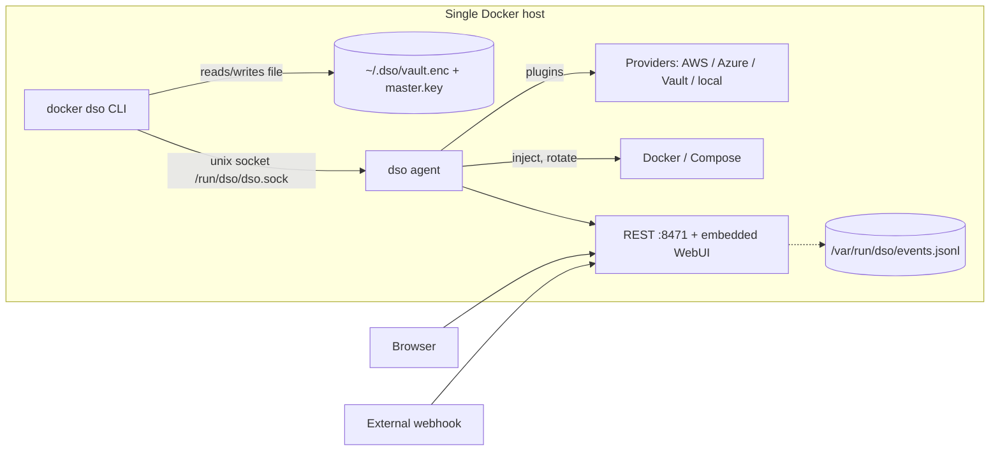
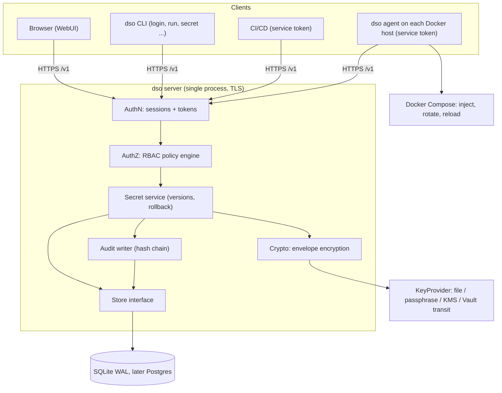
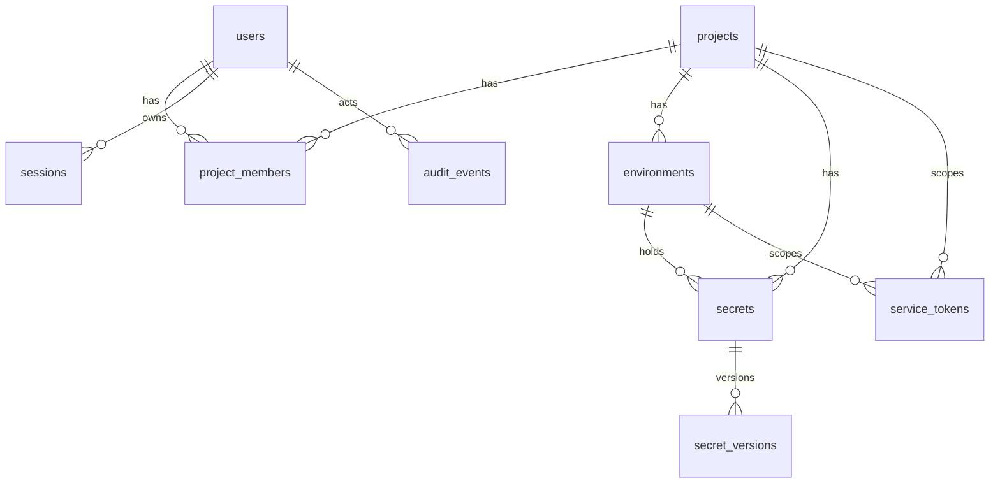

# DSO Central-Server Engineering Design Report

Status: **DRAFT for approval. Investigation and design only. No source, config, dependency, schema, asset or Git history was changed.**
Date: 2026-10-16. Branch inspected: `feature/webui-phase1` (dirty tree, 20+ modified and 10 untracked files, left untouched; 3 stashes exist and were not touched).

Legend used throughout:
- **[V]** verified by reading code in this session (no runtime execution unless stated).
- **[R]** design recommendation.
- **[A]** unresolved assumption / needs a decision.
- **No tests, builds or binaries were executed.** Every "confirmed" below is a code-level confirmation, not a demonstrated exploit, unless explicitly noted.

---

## 1. Executive summary

DSO today is a **single-host Docker secret injector**: providers (AWS, Azure, Vault, a local encrypted file) feed an agent that injects secrets into Compose services and rotates containers. It has no server-side concept of users, projects, environments, versions or roles. The WebUI is an operational dashboard for one hard-coded operator.

The previous review was mostly right but had two material errors, corrected here:
1. It said a non-loopback REST listener could start unauthenticated. **Incorrect**: `StartRESTServer` refuses that (`internal/server/rest.go:1227`). The real defect is narrower: on a loopback bind with `DSO_AUTH_TOKEN` unset, **the WebUI login is not enforced at all**.
2. It said audit events are in-memory only. **Partially incorrect**: `EventStore` also appends to `/var/run/dso/events.jsonl` and replays it. It is still not a durable or tamper-evident audit trail.

Recommended direction: add a **central server mode** (new `dso server` role in the existing binary) on **SQLite (WAL, pure Go)** behind a `Store` interface, with an **envelope-encryption key hierarchy** (root key provided by a pluggable KeyProvider, per-project DEKs, per-version ciphertext with bound AAD), **project/environment RBAC**, **hashed scoped service tokens**, and a **hash-chained persistent audit log**. The existing agent and injection engine consume the server as just another secret provider, so runtime injection and rotation stay first-class and unchanged. Local mode stays as-is behind the same `Store` interface.

Milestone 0 (security fixes) is small and independent and should ship first.

---

## 2. Validated findings and evidence

Classes: **1** confirmed vulnerability/defect · **2** confirmed architectural limitation · **3** partially correct / context-dependent · **4** not reproducible / incorrect · **5** not yet verified.

| # | Finding | Class | Severity | Evidence |
|---|---|---|---|---|
| F1 | REST API (incl. all of `/api/*`) is open when `DSO_AUTH_TOKEN` is unset, **even with WebUI enabled** | **3** (loopback only) | **High** if a reverse proxy, other local users, or DNS rebinding apply; Medium otherwise | see F1 |
| F2 | Webhook endpoint requires two different bearer tokens in one header | **1** | Medium (functional + design) | see F2 |
| F3 | Master key stored next to the vault; encryption boundary is weak | **2** | Medium | see F3 |
| F4 | Concurrent vault writes lose updates; non-durable write | **1** | Medium (High in CI) | see F4 |
| F5 | WebUI auth: single operator, in-memory sessions, cookie lifetime and limiter issues | **2 + 3** | Low–Medium | see F5 |
| F6 | CSRF protection is client-only, not enforced server-side | **3** | Low | see F6 |
| F7 | Sensitive endpoints (`/api/config/raw`, `/api/audit`) | **4** (for leakage) / **2** (no authz tiers) | Low / n/a | see F7 |
| F8 | Audit not durable / not tamper-evident | **3 + 2** | Medium | see F8 |
| F9 | Secret listing reflects agent cache, not the vault | **2** | Info | see F9 |
| F10 | Plaintext on disk via `dso export` | **1** | Medium | see F10 |
| F11 | CLI: overlap, dead code, inconsistent error handling, no `login`/`run` | **3 / 1 / 2** | Low | see F11 |
| F12 | Frontend dependencies, build artifacts, stale docs, versions | **3 / 5** | Low | see F12 |
| F13 | Authorization on sensitive operations | **2** | High (for any multi-user product) | see F13 |

### F1: Unauthenticated access when `DSO_AUTH_TOKEN` is unset — **Class 3**
- `internal/auth/auth.go` `Verify`: empty configured token → returns nil ("skip auth") **[V]**.
- `internal/server/rest.go` `authorized()`: `tokenOK := s.Auth == nil || s.Auth.GetToken() == ""`; if true, returns true **before** the WebUI session check **[V]**. So with no token, every `/api/*` route is reachable without a session, including `POST /api/secrets/{name}/rotate`, `POST /api/sessions/revoke-others`, `/api/audit`, `/api/events/ws`.
- `pkg/config/config.go:388` validation requires `webui.username` and a bcrypt `password_hash` when WebUI is enabled but does **not** require a token **[V]**, so a config that looks locked (login page, password hash) is actually open.
- **Mitigation already present** (my earlier claim was wrong here): `StartRESTServer` (`rest.go:1227`) returns an error for non-loopback binds without a token, and enforces token length 16–512 bytes. Default `--api-addr` is `127.0.0.1:8471` (`internal/cli/agent.go:283`). `bindsPublic()` treats an unparsable address as non-public (`net.SplitHostPort` error → false) **[V]**.
- **Context that makes it worse:** a same-host reverse proxy (connections arrive from loopback, nothing is "public"), shared hosts / other local users, and DNS rebinding (REST handlers do not check the `Host` header; only the WS origin check does) **[V]** that the loopback guard assumes away. DNS rebinding is **not demonstrated**, only code-plausible.
- **Safe repro (not executed):** `httptest` against `RESTServer{Auth: NewAuthenticator() /*token unset*/, WebUIAuth: mgr}`; `GET /api/audit` without cookie → expect 401, actual 200.
- **Fix [R]:** when `WebUIAuth != nil` (or any credential source exists), "no bearer token configured" must mean *bearer auth disabled*, not *everything open*. Only the explicit legacy mode (WebUI disabled, loopback, no token) stays open, behind a logged warning. **Breaking change:** loopback scripts that call the API unauthenticated while the WebUI is enabled will start getting 401. Need to confirm what `dso logs --api-addr` (`internal/cli/logs.go:129`) and any other CLI client sends **[5]**.

### F2: Webhook credential collision — **Class 1**
- `/api/events/secret-update` is not in `publicPaths`, so `authorized()` runs first and, when `DSO_AUTH_TOKEN` is set, requires `Authorization: Bearer <DSO_AUTH_TOKEN>` **[V]**. `handleSecretUpdate` then compares the **same header** to `"Bearer "+webhook.AuthToken` (`rest.go:474`) **[V]**.
- Both can only pass if the two tokens are byte-identical. A third-party system holding only the webhook token is rejected at the first gate; a caller holding the global token is rejected at the second. The comment (SEC-C3, "second factor") assumes two headers.
- Whether `rest_test.go:317/347/563` (webhook tests) set the global token **[5]**; if they construct `RESTServer` with `Auth` unset they would not exercise the collision.
- **Fix [R]:** webhook gets its own header (`X-DSO-Webhook-Token`) or HMAC signature (`X-DSO-Signature: sha256=…` over body + timestamp, replay window), is exempt from the global bearer gate, and is rate-limited. Keep accepting the old form for one release with a deprecation warning. **Breaking:** none if the legacy form stays.

### F3: Master key and encryption boundary — **Class 2**
- `pkg/vault/vault.go`: key = `DSO_MASTER_KEY` env or `~/.dso/master.key` (0600), generated as 32 random bytes hex, stored in the **same directory** as `vault.enc` **[V]**. Anything that can read the directory (backup, copied home dir, stolen disk, container volume) gets both. Encryption therefore only protects a leak of `vault.enc` alone.
- `pkg/vault/crypto.go`: AES-256-GCM with a key derived by Argon2id (time 3, 128 MiB, 4 threads) and a **fresh salt per save**; no AAD **[V]**. Argon2id is designed for low-entropy passwords; the input here is already a 256-bit random key, so it adds ~128 MiB/CPU cost per `Load`/`Save` with no security gain. This is neither broken nor protective; it is a misapplied primitive. The ciphertext also binds nothing (no version, no vault id) so blobs are swappable between vaults sharing a key.
- `getMasterKey` silently `chmod 0600`s the file on every read **[V]** (hides permission drift, but not harmful).
- Whole vault is one JSON blob; every `Get` decrypts everything **[V]**.
- **Fix [R]:** see §5 key hierarchy. For Milestone 0 only document the limitation and add a doctor check (key file on same filesystem as the vault, perms, env-var presence).

### F4: Vault concurrency and crash safety — **Class 1**
- `LoadDefault` reads and decrypts once; `Set`/`SetBatch` mutate that in-memory copy and `saveLocked()` rewrites the **entire file** **[V]**. The `sync.RWMutex` is per-process. There is no file lock anywhere in `pkg/vault` (the only `flock` is `internal/rotation/lock_manager.go`) **[V]**. Two `dso secret set` processes (or CLI + CI) each load the same snapshot; the later rename wins and **silently drops the other's write** (lost update).
- Temp file is a fixed name `vault.enc.tmp` **[V]**: two concurrent savers write the same temp path (corrupt interleaving possible, then one rename).
- No `fsync` of the temp file or the directory (`grep Sync()` in `vault.go` → none) **[V]**: a power loss after `rename` can leave a zero-length or stale vault.
- Integrity: the embedded SHA-256 "checksum" is inside the encrypted payload, so it only detects accidental corruption, which GCM already detects.
- **Not executed.** Safe repro: two processes with `HOME=$(mktemp -d)` and a throwaway `DSO_MASTER_KEY`, each running `secret set` for different keys in a loop, then count keys.
- **Fix [R]:** short-term (Milestone 0): advisory `flock` on a lock file around load-modify-save, unique temp file via `os.CreateTemp` in the same dir, `fsync` file then dir. Long-term: replaced by Milestone 1 storage.

### F5: WebUI authentication — **Class 2 + 3**
- Single operator from `webui.username` / `webui.password_hash` (bcrypt) **[V]** (`internal/webuiauth/session.go`). No password-change flow (the Settings page says so), no MFA/SSO/API tokens.
- Sessions: in-memory map, 256-bit random token, cap 10 (oldest evicted), **idle timeout only**, no absolute lifetime **[V]**. Sessions are lost on restart (by design). Logout and "revoke others" work **[V]**.
- **Cookie lifetime (likely defect, not run [5]):** `SessionCookie` sets `MaxAge = idleTimeout` and is only issued at login (`handleAuthLogin`); `Validate` extends the server-side idle timer but never re-issues the cookie. A continuously active user would be logged out by the browser after `idleTimeout` since login.
- Login limiter: 5 failures / 15 min **per `RemoteAddr` IP** (`loginlimiter.go:121`) **[V]**. Behind a reverse proxy all users share the proxy IP: five typos lock out everyone; an attacker can lock out the operator by failing five times. No trusted-proxy handling.
- Username check: bcrypt always runs, so timing does not trivially reveal a valid username **[V]** (good). Password policy: none enforced on hash creation beyond bcrypt's 72-byte limit [A].
- Cookie flags: `HttpOnly`, `SameSite=Strict`, `Secure` per `webui.cookie_secure` (auto infers from bind address) **[V]**.

### F6: CSRF — **Class 3**
- Server does not validate any CSRF header. `grep -i csrf` over `internal pkg cmd` hits only a compiled frontend chunk **[V]**.
- `web/lib/csrf.ts` is imported by `web/lib/api-client.ts` (the axios client used by `lib/api/auth.ts`) but **not** by `api-fetch.ts`, which most `lib/api/*` use **[V]**. It is client-side theater, not a control.
- Actual protection: `SameSite=Strict` cookie + bearer tokens for non-browser clients. Residual risk: cookies ignore *port*, so another web app on `localhost:<other port>` is same-site and can issue authenticated state-changing requests (rotate, revoke sessions). **Context-dependent, low.**
- **Fix [R]:** either delete `csrf.ts` or implement a real double-submit/Origin check server-side on cookie-authenticated unsafe methods. Prefer the `Origin`/`Sec-Fetch-Site` check (cheap, stateless).

### F7: Sensitive endpoints — **Class 4 (leak) / Class 2 (authz)**
- `/api/config/raw` returns only secret **names**, provider **names** (`handleConfigRaw`, `rest.go:357`) **[V]**. No credentials or values. The "raw config leaks" concern is **not reproducible**.
- `/api/audit` returns recent `EventStore` events to any authenticated caller **[V]**; by F1 it may be unauthenticated. Metadata only; no values were observed in the handlers read.
- `/api/secrets` returns metadata (name, provider, status, timestamps), never values **[V]**.

### F8: Audit persistence — **Class 3 + 2**
- `EventStore` (`internal/server/eventstore.go`) keeps a bounded in-memory slice (500) **and** appends JSONL to `/var/run/dso/events.jsonl` (0600) with startup replay **[V]**. `/var/run` is tmpfs on most Linux distributions [A: verify on target], so history is lost on reboot. `handleAudit`'s own comment says it is "NOT a durable audit trail" **[V]**.
- `internal/audit.Log` writes structured logs to stdout via zap (through the redaction core) **[V]**. Retention depends on journald/Docker log driver.
- No actor on all events, no signing/chain, same user owns the file, no size cap/rotation verified [5].

### F9: Secret listing source — **Class 2**
`handleListSecrets` → `Cache.ListKeys()` merged with config metadata **[V]**. It lists the **agent cache**, not the vault. The CLI `secret list` reads the vault file. These two never reconcile.

### F10: Plaintext on disk — **Class 1**
- `dso export` creates the output with `os.Create` (mode 0666 before umask, typically 0644) **[V]** (`internal/cli/export.go:55`), default `.env.local`. It prints a warning but the file is group/world-readable on a default umask. **Fix:** `O_CREATE|O_EXCL|O_WRONLY` 0600, refuse if the file exists, warn if not gitignored.
- `dso up` writes a mutated compose AST to `os.CreateTemp` (0600) **[V]**; whether it contains resolved secret **values** or only references **[5]**. Must be checked before any claim.
- `dso env import <file>` reads a user-supplied plaintext `.env` (expected). `secret set` reads value from a TTY or stdin, never argv **[V]** (good).
- Injection: `dso://` env values are intentionally visible in `docker inspect`; `dsofile://` uses tmpfs mounts **[V]** (documented in README).

### F11: CLI quality — **mixed**
- Overlap: `setup` (`NewSetupCmd`), `bootstrap`, `system setup` (provider plugin install, real). **[V]**
- `newSystemDoctorCmd` (`internal/cli/utils.go:148`) is a no-op returning nil, but it is **never registered** (only its definition appears) → **dead code, not a user-visible no-op** (Class 4 for "no-op command", Class 3 for "dead code"). `stubs.go` holds the real `version` command despite its name.
- Error handling: `export.go` uses `Run` + `os.Exit(1)`; `secret.go` uses `RunE` **[V]**. No common `--output json` [A: not exhaustively surveyed].
- `login`, `logout`, `whoami`, `run`, `secret delete|history|rollback`: **absent** (no matching `Use:`) **[V]**. `secret` has only `set|get|list` **[V]**.
- **Naming conflict:** `dso env` is already a command (`NewEnvImportCmd`, `Use: "env"`, subcommand `import`). The proposed `dso env` (environments) must be a sibling subcommand of that parent or use another name (see §8).

### F12: Frontend, artifacts, docs, versions — **Class 3 / 5**
- Authoritative embedded assets: `internal/webui/assets` (tracked, 76 files, built by `make webui-build` → `scripts/build-webui.sh`) **[V]**. `ui-dist/` and `web/out/` are **gitignored** local copies; `ui-dist` diverges from `internal/webui/assets` **[V]**. `web/package.json` `export` still copies to `../ui-dist`: a stale script, not repo bloat.
- `axios` is used (`lib/api-client.ts`); `@tanstack/react-query`, `react-table`, `react-virtual`, `monaco-editor` showed up only in three `lib/` files in a combined grep, likely unused **[5]**; confirm with `depcheck`/`knip` before removing.
- Versions: `web/package.json` 3.6.0; latest git tag `v3.5.24`; CLI version injected via ldflags (`Makefile` uses `git describe`; `cmd/dso/main.go` defaults to `"dev"`); README says "Current version: latest" **[V]**. `CHANGELOG.md` points to `docs/audit/DECISION_LOG.md`, which does **not exist** in this checkout **[V]**.
- Tracking generated assets in Git risks drift between `web/` source and `internal/webui/assets`; whether CI enforces freshness **[5]** (a `webui` CI job is referenced in the Makefile comment).

### F13: Authorization on sensitive operations — **Class 2**
There is **no authorization layer**: `authorized()` answers only "authenticated?". Every authenticated principal can rotate, revoke sessions, read audit and subscribe to events **[V]**. Audit `actor` for rotation is the session username or the literal `"webui"` (bearer-token callers are not individually identifiable) **[V]**. This is acceptable for a single operator and unacceptable for multi-user.

### Items that could not be verified
Webhook test coverage vs F2; whether any CLI client sends the token (F1 breakage); cookie-expiry behavior in a real browser (F5); whether the `dso up` temp file contains values (F10); events.jsonl rotation/size; unused frontend dependencies; existing CI freshness check for embedded assets; correctness of the uncommitted changes in watcher/rotation/agent (out of scope, not reviewed).

---

## 3. Current architecture and limitations



Limitations: no remote client model, no identity beyond one operator, vault is a single file with no locking or history, audit is volatile, no authorization tiers, the CLI vault path and the agent path never share a source of truth.

---

## 4. Proposed target architecture



Principles:
1. **The server is the only process that opens the database** in central mode. This removes multi-process write races (F4) by construction.
2. **The agent consumes the server as a provider** (`type: dso-server`) through the existing provider abstraction, so injection, rotation triggers and container reloads are unchanged **[A: confirm the provider interface can carry versions and ETags; `pkg/provider` was not read in depth]**.
3. **Local mode** = same `Store`/`Crypto` code with a `LocalStore` (no users, trust = OS user). Central and local share *functionality*, not *trust*: local mode never presents tokens or RBAC it does not enforce, and central-server clients never read a database file directly.

### Authentication and identity
- Users: email/username + password (Argon2id for new hashes; keep bcrypt verification for the migrated operator), mandatory password change on first login for bootstrap admin. TOTP in a later phase; OIDC explicitly deferred.
- Sessions: persisted in DB, opaque 256-bit token, stored as SHA-256 hash, idle + absolute lifetime, re-issued cookie on activity, per-user revoke-all.
- CLI login: device-code style (`dso login --server URL` prints code, user approves in the WebUI) or `--with-password` for headless; yields a revocable **user token** with 7-day absolute lifetime, stored in `$XDG_CONFIG_HOME/dso/credentials` (0600) or the OS keychain.
- Bootstrap: `dso server init` creates the DB, generates the root key via the chosen KeyProvider and prints a one-time admin setup URL/password to stdout once.

### Authorization and RBAC
- Roles are **per project**, with **per-environment scoping** of membership. Built-in roles: `owner`, `admin`, `developer`, `reader`, plus `auditor` (audit read only). Custom roles are deferred (YAGNI).
- Permissions (fixed enum): `secret:list` (names only), `secret:read` (values), `secret:write`, `secret:delete`, `secret:rollback`, `project:manage`, `member:manage`, `token:manage`, `audit:read`.
- **Deny by default; checks happen in the service layer, not in HTTP handlers**, so CLI/UI/agent cannot diverge.
- Instance-level: `instance_admin` flag on user (create projects/users, view all audit). No organizations/teams in v1.

### Storage choice: SQLite vs PostgreSQL

| Criterion | SQLite (WAL) | PostgreSQL |
|---|---|---|
| Standalone install | Single file, zero ops | Extra container/service to run, secure and back up |
| Docker-first fit | Excellent | Good, but doubles the install story |
| Concurrent writers | Serialized, fine for a secret store (writes are rare; reads dominate) | Excellent |
| Multiple server replicas / HA | No (single node; Litestream-style replication possible) | Yes |
| Build constraints | Repo builds `CGO_ENABLED=0` (Dockerfile) → needs a pure-Go driver (`modernc.org/sqlite`) | `pgx`, pure Go |
| Backup | Online `VACUUM INTO` / backup API, trivial | `pg_dump` / PITR |
| Audit append-only enforcement | Triggers only; whoever owns the file can bypass | Separate DB roles can make the audit table insert-only |
| Migration path | Same SQL via `Store` interface | n/a |

**Recommendation [R]:** start with **SQLite**. A secret store is read-heavy, low-write, and the product's identity is "one binary + Docker". PostgreSQL is justified by *HA* or *audit separation of duties*, not by "multiple clients" (clients talk to the server, not the DB). Define a narrow `Store` interface and keep SQL portable (no SQLite-only features) so a Postgres implementation can be added in a later milestone **when a concrete HA requirement exists**. Cost accepted: no active-active; mitigation is documented backup/restore and fast restart.

### Encryption and key management
Honest framing: AES-GCM and Argon2id are not a design. The security comes from **who holds which key and where it lives**.

Key hierarchy [R]:
```
Root key (KEK_root)  -- held by a KeyProvider, never stored in the DB
  └─ wraps → Project DEK (one per project, random 256-bit, stored wrapped in DB)
        └─ encrypts → each secret VERSION (AES-256-GCM, random 96-bit nonce,
                      AAD = project_id | environment_id | secret_id | version)
Audit HMAC key -- derived from root via HKDF("audit"), separate from data keys
```
- **KeyProvider options** (in order of delivery): `file` (0400, must be on a different path/volume than the DB; doctor warns otherwise), `passphrase` (Argon2id-derived KEK, operator unseals at start; appropriate use of Argon2id), `env` (container secrets), then `aws-kms` / `vault-transit` / `azure-keyvault` (DSO already links these SDKs). KMS providers unwrap project DEKs at start and hold them in memory only.
- Per-project DEKs give blast-radius containment and cheap rotation: rotating the root re-wraps N DEKs; rotating a DEK re-encrypts that project's versions in a transaction.
- AAD binding stops ciphertext being swapped between secrets/versions/projects.
- Secret **names** are not encrypted (needed for listing/indexing); document that names are metadata.
- Limitations stated plainly: a server process compromise exposes unwrapped DEKs in memory; a DB + root key theft exposes everything; there is no HSM-grade protection. A sealed/unsealed state (server refuses secret operations until a passphrase/KMS is available) is the available mitigation.

### Versioning, rollback, deletion
- Every write creates an immutable `secret_versions` row; `secrets.current_version_id` points at the active one.
- **Rollback = create a new version copying an old version's ciphertext reference** (not mutate history), audited as `secret.rollback`.
- **Delete = soft delete** (`deleted_at`, versions retained for a configurable retention, default 30 days) then **purge** (hard delete versions + wrapped data) via an explicit admin action or retention job; purge is audited with name only. Cryptographic erasure on project deletion = destroy the project DEK.

### Service tokens
- Format `dso_st_<token_id>.<secret>`; DB stores `token_id`, **SHA-256(secret)** (secret is 256-bit random, so a fast hash is appropriate), scopes, `expires_at`, `last_used_at`, `revoked_at`. Shown once.
- Scope = exactly one project + one environment (or explicit set) + permission subset (`secret:read` typically). Optional source CIDR allow-list.
- Every request re-checks revocation/expiry/scope in the DB (no cached allow decisions beyond a few seconds), so revocation is effectively immediate.
- Rotation: create new token, deploy, revoke old (overlap supported); `dso token rotate` automates it.
- Tokens are non-expiring only by explicit `--no-expiry`, which is audited and shown in the UI.

### Persistent audit logging
- Table `audit_events` is append-only. Each row stores `seq`, UTC timestamp, actor type/id, action, resource refs, outcome, client IP, request id, `prev_hash`, and `hash = HMAC(audit_key, prev_hash ‖ canonical_json(row))`. No secret values, ever (names and ids only).
- DB triggers reject UPDATE/DELETE. Be explicit about the limit: whoever holds both the DB file and the audit key can rewrite history. Mitigations: ship events out (syslog/S3/stdout JSON), periodically publish the chain head (`dso audit verify`), and (Postgres phase) use a separate insert-only DB role.
- Reads of secret values and failed auth attempts are audited; high-volume reads can be sampled only by explicit setting.

### Offline and server-unavailable behaviour
| Situation | Behaviour [R] |
|---|---|
| Running containers | Unaffected; they already hold their secrets. |
| Agent polling fails | Agent keeps last-known values in memory, marks provider `degraded`, emits alerts (existing alert engine), **does not rotate or restart** services on stale data. |
| New container start / `dso run` | Fail closed by default. Opt-in `--offline-cache` / `cache_ttl` uses an encrypted local cache (0600, key = local machine key), bounded TTL, scoped to what that token could read. |
| Rotation | Requires the server; no rotation decisions made from cache. Resumes with idempotent version comparison when the server returns. |
| Revocation | Token revoked on the server cannot be honored offline; the cache TTL is the exposure bound and must be documented. |

### Backup, restore, upgrade
- `dso server backup` (SQLite online backup → single file, encrypted with a backup key that is **not** the root key, plus a manifest with schema version and chain head), `dso server restore` (verifies schema, chain, and decryptability with a canary secret before swapping in), `dso server verify-backup`.
- Root key backup is a separate, explicit procedure (split custody; passphrase/KMS key ids are documented). A backup without its root key is useless by design.
- Forward-only migrations in `internal/store/migrations/NNNN_*.sql`, applied transactionally at start, with a pre-migration automatic backup and a schema-version check refusing to run on a newer DB.

---

## 5. Data model and security boundaries

Scope kept deliberately small: **one instance = one tenant**. No organizations or teams in v1.



```sql
-- illustrative DDL; portable SQL, ids are UUIDv7 text/blob
users(id PK, username UNIQUE, email UNIQUE NULL, password_hash, instance_admin BOOL,
      disabled_at NULL, created_at, password_changed_at)
sessions(id PK, user_id FK, token_hash UNIQUE, created_at, last_seen_at, expires_at, revoked_at NULL, ip, ua)
projects(id PK, slug UNIQUE, name, wrapped_dek BLOB, dek_key_id, created_at, deleted_at NULL)
environments(id PK, project_id FK, slug, name, position, UNIQUE(project_id, slug))
project_members(id PK, project_id FK, user_id FK, role, env_scope /* '*' or JSON list of environment ids */,
                UNIQUE(project_id, user_id))
secrets(id PK, project_id FK, environment_id FK, path, current_version_id FK NULL, deleted_at NULL,
        UNIQUE(environment_id, path))          -- uniqueness among non-deleted rows via partial index
secret_versions(id PK, secret_id FK, version INT, ciphertext BLOB, nonce BLOB, dek_version INT,
                created_by (user|token id), created_at, comment, UNIQUE(secret_id, version))
service_tokens(id PK, project_id FK, environment_id FK, name, token_hash, permissions, cidr NULL,
               created_by, created_at, expires_at NULL, last_used_at, revoked_at NULL)
roles/permissions: fixed in code (enum table role_permissions seeded by migration, not user-editable in v1)
secret_access_policies(id PK, project_id FK, environment_id FK NULL, path_glob, subject_type, subject_id, permission, effect)
   -- v1: only used for path-glob narrowing inside an environment; defer until the base model is proven
audit_events(seq PK AUTOINC, ts, actor_type, actor_id, action, project_id NULL, environment_id NULL,
             resource_ref, outcome, ip, request_id, prev_hash, hash)
```

Constraints and semantics:
- A secret belongs to exactly one environment of one project; the environment must belong to the same project (enforced by composite FK/check).
- Deleting a user: disable, revoke sessions and user tokens, keep audit references (never cascade-delete audit). Deleting a project: soft delete then purge; destroys the project DEK (crypto-erase).
- Environments are **independent authorization targets**; there is no inheritance between them.

Questions asked in the brief:
- **Can a user access production without staging?** Yes. `project_members.env_scope` is per user; a `reader` scoped to `[production]` sees nothing in `staging`. Default new members get no environments until granted; `owner/admin` implicitly all.
- **Can a token be limited to one project and environment?** Yes by construction: `service_tokens` has non-null `project_id` and `environment_id`, and the service layer rejects any resource outside them.
- **How are secrets encrypted, versioned, deleted?** See §4: per-version AES-256-GCM under a per-project DEK with bound AAD; immutable versions; soft delete then purge.
- **How are audit records protected?** Append-only triggers, HMAC hash chain, external shipping; stated residual risk if DB and audit key are both compromised.
- **How is access revoked when a user or token loses it?** Membership removal is effective on the next request (no authorization caching beyond seconds); disabling a user revokes all sessions and user tokens in one transaction; tokens are checked against `revoked_at/expires_at` per request. Already-fetched secret values cannot be recalled, so the response to a revocation of a compromised principal is to **rotate the secret**; the UI must offer that.
- **How do local and central modes share functionality without sharing trust?** Shared: crypto, versioning, `Store` interface, injection engine. Not shared: local mode has no principals and relies on OS file permissions; central mode never exposes the DB or root key to clients, and a client's local cache is bounded by its token's scope and TTL. A central-mode CLI never silently falls back to the local vault (and vice versa); the active context is always printed.

---

## 6. API and CLI contracts (proposed, not yet to be built)

### API conventions
- Base `/v1`, JSON, `Content-Type: application/json`, TLS required for non-loopback. Auth: `Authorization: Bearer <session|user|service token>`; browsers use the cookie plus an `Origin` check.
- Errors: `{"error":{"code":"forbidden","message":"…","request_id":"…"}}` with codes `unauthenticated(401) forbidden(403) not_found(404) conflict(409) validation(422) rate_limited(429) server_sealed(503)`. Never distinguish "no such secret" from "not allowed" for principals lacking `secret:list`.
- Pagination: cursor (`?limit=50&cursor=…`), response `{ "items":[…], "next_cursor":"…" }`.
- Secret values only returned by the explicit `…/value` endpoints and never by list/history.
- Existing unversioned `/api/*` routes stay for the agent/WebUI until deprecated.

| Area | Endpoint | AuthZ |
|---|---|---|
| Auth | `POST /v1/auth/login` {username,password}→ cookie / token | public + rate limit |
| | `POST /v1/auth/logout`, `GET /v1/auth/whoami`, `GET/DELETE /v1/auth/sessions[/{id}]` | self |
| | `POST /v1/auth/device` + `POST /v1/auth/device/token` (CLI login) | public / self |
| Projects | `GET/POST /v1/projects`, `GET/PATCH/DELETE /v1/projects/{p}` | member / `project:manage` |
| Environments | `GET/POST /v1/projects/{p}/environments`, `PATCH/DELETE …/{e}` | `project:manage` |
| Members | `GET/PUT/DELETE /v1/projects/{p}/members/{user}` {role, env_scope} | `member:manage` |
| Secrets | `GET /v1/projects/{p}/envs/{e}/secrets?prefix=` (names + metadata) | `secret:list` |
| | `PUT /v1/…/secrets/{path}` {value, comment}→ new version | `secret:write` |
| | `GET /v1/…/secrets/{path}/value[?version=]` | `secret:read` |
| | `DELETE /v1/…/secrets/{path}[?purge=true]` | `secret:delete` (purge: admin) |
| | `GET /v1/…/secrets/{path}/versions` (metadata only) | `secret:list` |
| | `POST /v1/…/secrets/{path}/rollback` {to_version} | `secret:rollback` |
| | `POST /v1/…/secrets:bulk-read` {paths[]} (used by `dso run` / agent) | `secret:read` |
| Tokens | `GET/POST /v1/projects/{p}/tokens` (value returned once), `DELETE …/{id}`, `POST …/{id}/rotate` | `token:manage` |
| Audit | `GET /v1/audit?project=&actor=&action=&from=&to=&cursor=`; `GET /v1/audit/verify` | `audit:read` / instance_admin |
| Health | `GET /healthz` (liveness), `GET /readyz` (DB + KeyProvider unsealed + migrations) | public, no detail |

Representative shapes:
```json
PUT /v1/projects/shop/envs/production/secrets/db/password
{ "value": "<redacted>", "comment": "rotated after incident 4411" }
→ 201 { "path":"db/password", "version": 7, "created_at":"…", "created_by":"user:alice" }

GET …/secrets/db/password/versions
→ { "items":[{ "version":7, "created_at":"…", "created_by":"user:alice", "comment":"…", "current":true }],
    "next_cursor":null }
```
Conditional writes: `If-Match: <version>` to avoid blind overwrites (409 on mismatch). Reads support `ETag`/`If-None-Match` so agents poll cheaply.

### CLI contract
Existing: `docker dso secret set|get|list <project>/<path>` (local vault), `docker dso env import <file> [project]`, `init`. These **must keep working unchanged in local mode**.

New contexts: `dso login --server URL [--context NAME]` stores a named context; the active context decides local vs. central. Without a context, behaviour is exactly today's.

| Command | Behaviour |
|---|---|
| `dso login` / `logout` / `whoami` | Device-code login; logout revokes the server token, deletes local credential; `whoami` prints server, user, roles, and context kind (local vs central). |
| `dso project list\|create\|rm` | Central only. |
| `dso env ...` | **Conflict:** already `env import`. Proposal: keep `env` as the parent and add `env list\|create\|rm` beside `import`; disambiguate by flag `--project`. Needs your decision (see §12). |
| `dso secret set\|get\|list\|delete\|history\|rollback` | Same grammar. Central: `--project P --env E` (or `P/E/path`); local: unchanged `project/path`. `set` reads TTY/stdin only (never argv). `get` needs `--reveal`-free but prints only to stdout. `delete` asks confirmation, `--purge` needs admin. `history` shows versions without values; `rollback --to N`. |
| `dso run -- cmd args` | See below. |

Output: all new commands support `--output json|table` and use `RunE` returning typed errors with stable exit codes (0 ok, 1 generic, 2 usage, 3 unauthenticated, 4 forbidden, 5 not found, 6 server unavailable).

### `dso run -- <command>`
- Flow: resolve context → `POST secrets:bulk-read` for `--project/--env` (token from env `DSO_TOKEN` or stored credential) → build child env = parent env + secrets (secrets win, `--no-inherit` for a clean env) → `exec` the command **without a shell**.
- Process model: prefer `syscall.Exec` replacement (no wrapper process, exit code and signals natively correct). Where DSO must stay alive (redaction, cache cleanup), use `os/exec`, inherit stdio, forward `SIGINT SIGTERM SIGHUP SIGQUIT SIGUSR1/2`, set the child in the same process group, and exit with the child's code (signal death → `128+signo`). If the child cannot start: exit 127/126.
- No secret value ever touches DSO's own logs, argv, or files. `RLIMIT_CORE=0` and `PR_SET_DUMPABLE=0` on the wrapper; `--redact` (opt-in) filters exact secret values from forwarded stdout/stderr, **best-effort only** (it cannot catch encoded/partial/transformed values).
- Stated limitations: environment variables are readable via `/proc/<pid>/environ` by the same user and root; inherited by every grandchild; commonly leaked by crash reporters and `printenv`/debug endpoints; secrets in child memory cannot be scrubbed by DSO. A `--file-fd`/tmpfs mode (`dsofile://` analogue) is the safer alternative for apps that support it.

---

## 7. Backward compatibility and migration

- **Local vault → central:** `dso server import-vault` reads `~/.dso/vault.enc` with the master key, maps `project` → project and `global` → a chosen project, creates a default environment (name given by the operator; the legacy model has none), writes version 1 with comment `imported`. Dry-run first; idempotent (skips identical values); source vault untouched.
- **WebUI operator → first admin:** config `webui.username/password_hash` seed the bootstrap user once (bcrypt hash accepted), flagged `must_change_password`.
- **`DSO_AUTH_TOKEN`:** becomes a legacy instance-admin token during a deprecation window (documented removal version).
- **Agent configs:** `providers.<name>.type: dso-server` is additive; existing `dso://` and `dsofile://` references are unchanged.
- **Breaking changes (by milestone):**
  - M0: F1 fix makes unauthenticated loopback API calls fail when the WebUI is enabled; `dso export` file mode becomes 0600 and refuses overwrite; webhook gains a new header (old form deprecated, not removed).
  - M1: local vault format version 2 (file lock; still readable by old binaries only until first write by new one: document); `Argon2` use changes only in the new store.
  - M2/M3: new `/v1` API; legacy `/api/*` remains.
- Rollback strategy per milestone: each ships behind a feature flag or new command, with backward-readable data until the last step.

---

## 8. Milestones

### Milestone 0 — Security fixes (no new architecture)
Deliverables: F1 deny-by-default auth when WebUI/credentials exist; F2 webhook header/HMAC; F4 file lock + unique temp + fsync in `pkg/vault` (interim); F10 `export` 0600 + `O_EXCL`; F5 cookie re-issue + proxy-aware limiter option (trusted-proxy setting, default off) + absolute session lifetime; F6 remove client CSRF theater or add `Origin` check; doctor checks for key/vault co-location; delete dead `newSystemDoctorCmd`.
Depends on: nothing.
Acceptance (measurable): unauthenticated request to each `/api/*` route returns 401 when `webui.enabled` and no token; webhook succeeds with only its own credential and fails with the global one alone; 50 parallel `secret set` processes on distinct keys leave 50 keys present; killing the process mid-save never yields an unreadable vault (fault-injection test); exported file mode is 0600; existing test suite unchanged and green.
Tests: new regression tests (see §9) plus `go test ./internal/server/... ./pkg/vault/... ./internal/webuiauth/... ./internal/cli/...`, `go vet`, `-race`.
Migration risk: scripts using the loopback API without a token. Completion: all F1/F2/F4/F10 tests merged and CI green.

### Milestone 1 — Storage and key management
Deliverables: `internal/store` interface + SQLite implementation (pure Go driver), migration runner, `internal/crypto` (envelope, KeyProvider: file+passphrase first), `dso server init|backup|restore|import-vault`, key rotation commands.
Depends on: M0 (lock/fsync lessons, tests). Must decide driver and dependency (A).
Acceptance: concurrent-writer test with N goroutines + M processes shows no lost update (serialized by the server, SQLite busy-timeout test), crash-during-write test, wrong key/tampered ciphertext/AAD-swap tests fail closed, backup→restore round-trip on a fresh host passes, import-vault is idempotent and dry-run leaves nothing changed.
Migration risk: root-key custody mistakes; mitigated by `doctor` and a mandatory backup confirmation at `init`.

### Milestone 2 — Identity and authorization
Deliverables: users, persistent sessions, bootstrap flow, roles + `env_scope`, service tokens, central authz service-layer checks, rate limiting per principal.
Depends on: M1. Acceptance: authorization matrix test (every endpoint × principal × resource) passes; cross-project and cross-environment access attempts are 403/404; token revocation takes effect within one request; disabled users lose all sessions atomically.

### Milestone 3 — Central secret management
Deliverables: projects/environments/secrets/versions/rollback/delete+purge APIs, persistent hash-chained audit, `dso login|logout|whoami|project|env|secret|run`, `dso-server` provider for the agent.
Depends on: M2. Acceptance: end-to-end test (login → set → run → rollback → audit verify); `dso run` exit-code/signal tests; agent rotates a container from a server-sourced secret in the existing integration harness; audit chain verifies and detects an edited row.

### Milestone 4 — Web UI
Deliverables: secret CRUD/history/rollback screens, members/tokens administration, audit viewer, honest capability discovery (`/v1/capabilities`) so the UI hides what the server lacks; remove unused dependencies; single build path to `internal/webui/assets`.
Depends on: M3. Acceptance: UI tests (vitest + the existing Playwright e2e dir) per workflow; no UI element calls an endpoint that does not exist; `npm run build` reproducible, embedded assets match source in CI.

### Milestone 5 — Production hardening
Deliverables: backup/restore/upgrade drills, offline-cache behaviour, revocation drills, load and concurrency tests, deployment and operational-security docs, threat-model update (`THREAT_MODEL.md` exists), optional Postgres `Store` if an HA requirement has appeared.
Acceptance: documented RPO/RTO met in a restore drill; upgrade N-1→N with data intact; chaos tests (server down during rotation, KMS unavailable) behave per the offline table.

---

## 9. Test and verification strategy

Use existing conventions: Go `testing` with table tests and `httptest` (as in `internal/server/*_test.go`), `-race`, `test/integration` for Docker flows, `vitest` + Playwright for the frontend.

| Area | Test |
|---|---|
| Unauthenticated | Table test over every route: no credentials → 401; with `WebUIAuth` set and no token → 401 (regression for F1). |
| Bad/expired creds | Wrong password, expired session, expired/revoked token, malformed bearer, oversized token. |
| Cross-scope | User scoped to `production` requests `staging`; token for project A reads project B; same path in two environments is isolated. |
| Token scoping/revocation | Revoked between two requests; expiry boundary with injectable clock; overlap during rotation. |
| Concurrent writes | `-race` goroutine test; multi-process test with `os/exec` and a temp `HOME`; version numbers strictly sequential, no gaps/dupes. |
| Version integrity/rollback | Rollback produces new version; history immutable; AAD swap and bit-flip tamper tests fail closed. |
| Crypto/KMS failures | Wrong root key, missing KeyProvider, sealed server returns 503 and writes nothing, KMS timeout, DEK rotation interrupted (transactional). |
| Audit | Every mutating endpoint emits an event; no secret value in any event (scan fixtures); chain verify detects modification/deletion; non-`audit:read` principal gets 403. |
| Restart / interrupted writes | Kill -9 during write (fault injection around rename/commit); restart and verify DB integrity (`PRAGMA integrity_check`). |
| Migration | Golden legacy-vault fixtures (v1.0 format) → import → compare; re-import is a no-op. |
| CLI `dso run` | Exit code propagation (0, nonzero, signal-killed), signal forwarding (SIGTERM reaches child and grandchildren), no shell expansion, no secret in argv/files/DSO logs (`strace`-free: assert via fixture child that prints its own env vs. DSO stderr). |
| Compose compatibility | Existing `test/integration` rotation, shadow-clone, stress tests run unchanged against local mode and against a server-backed provider. |
| Regression | Full existing suite must stay green; tests are not edited to pass. |

**Checks actually executed in this session:** none (read-only inspection only: `git`, `ls`, `grep`, `sed`, file reads). Everything in §2 is code-level. Items needing runtime proof are labelled **[5]** and listed in §2.

---

## 10. Risks of the plan itself
- Scope: M1–M4 are large; each milestone must have its own spec/plan cycle.
- Provider interface compatibility with versioned/ETag reads is assumed, not verified.
- SQLite pure-Go driver choice affects binary size, performance and licensing review.
- The uncommitted working tree (20+ files in watcher/rotation/agent/server) overlaps with files M0 will touch (`internal/server/rest.go`, `internal/cli/*`): M0 should start from a committed baseline to avoid entangling unreviewed changes.

---

## 11. Open questions and decisions requiring approval
1. **Config/UX for the M0 breaking change (F1):** Make "WebUI enabled + no token" require login (recommended), or require `DSO_AUTH_TOKEN` to be set as well?
2. **Webhook:** new `X-DSO-Webhook-Token` header only, or HMAC signature (recommended) with legacy fallback for one release?
3. **Baseline:** may M0 be done on a new branch off the current `HEAD`, leaving your uncommitted changes untouched (they would need to be committed or stashed by you first, or M0 uses a separate worktree)?
4. **Storage:** approve SQLite-first behind a `Store` interface and a pure-Go driver (`modernc.org/sqlite`)?
5. **Key custody default:** `file` (simple, weak), `passphrase` (unseal at start, needs operator on restart), or KMS first? Recommendation: ship `file` + `passphrase`, KMS in M5.
6. **CLI naming:** extend the existing `env` parent (`env import`, `env list`) or rename environment management to avoid the collision?
7. **Single instance = single tenant** (no organizations/teams in v1): confirm.
8. **Deprecation windows:** how long to keep `DSO_AUTH_TOKEN` as a legacy admin token and the legacy webhook header?
9. **Docs hygiene:** `CHANGELOG.md` references a missing `docs/audit/DECISION_LOG.md`; restore it or drop the reference?
