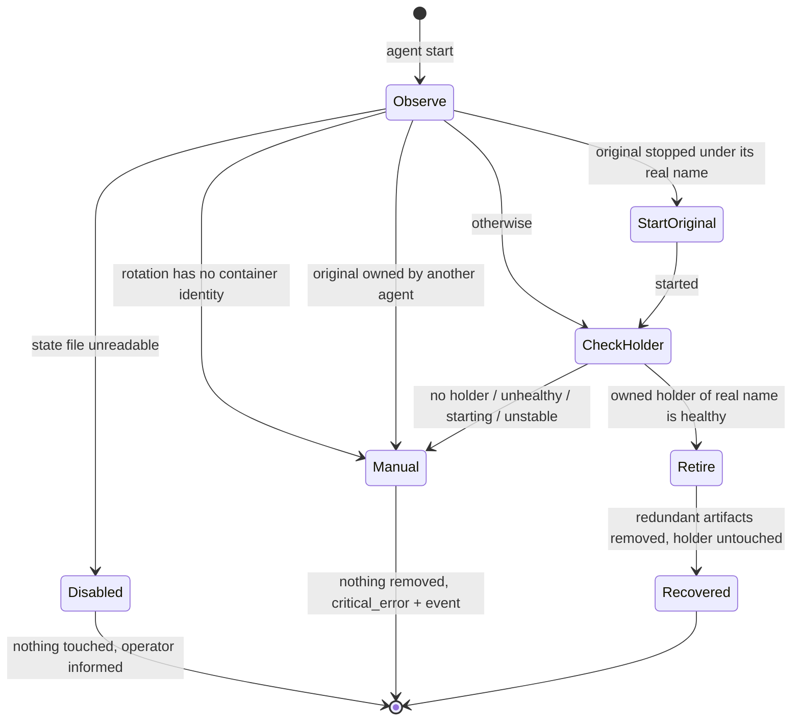

# M0-04 — Rotation recovery: current state machine, defects, and the safe design

## 1. Before this change (as audited, commit 07b42b3)

**Persisted state** (`<state dir>/rotations.json`, `StateTracker`): one record per `provider:secret:<comma-joined original IDs>` with `status` in `in_progress | completed | rollback_required | recovered | critical_error`, `original_container_id` (a comma-joined string), an always-empty `new_container_id`, and timestamps. It is written by `agent/trigger.go` around the whole `TriggerReload` call. The rolling/restart strategies in `internal/rotation` and `internal/watcher` do **not** journal their internal steps (create candidate, hand off proxy, rename, retire old).

**Transitions of the rolling strategy** (observable in Docker, not in the journal): original `app` → candidate `app_dso_new_<ts>` created → delivered/verified → proxy handoff → `app` renamed `app_dso_backup_<ts>` → candidate renamed `app` → backup removed. Restart strategy: original renamed `app_old_<ts>`, replacement created as `app`.

**Recovery**: at agent start, `RecoverFromCrash` (only for rotations older than five minutes) removed **every** owned container whose name matched an artifact pattern — in every service, not just the rotating one — *before* inspecting the original; then `CleanupOrphanedContainers` removed every owned artifact-named container again, unconditionally.

**Known unsafe transitions**
1. Crash between the two renames: nothing holds `app`; backup and candidate may each be the only running copy; both were deleted (S103).
2. Crash after a completed swap: backup deleted first, original then "missing" → reported critical although the service was fine (S102).
3. Multi-replica rotations stored `"id1,id2"` and recovery inspected that string as one ID.
4. The five-minute heuristic skipped recovery for a crash followed by a quick restart.
5. A corrupt state file was ignored (empty state) and the unconditional sweep still ran.
6. State was written with write+rename but no fsync.

## 2. Design now implemented

**Principle: Docker is authoritative, the journal is a hint.** A crash can land between a Docker action and its acknowledgement, so recovery decides only from what exists and what is verified healthy.

**Invariant:** an artifact (`<base>_dso_backup_*`, `<base>_dso_new_*`, `<base>_old_<digits>`) is removed only if (a) it is owned by this agent (`dso.owner`), (b) a *different* owned container holds the real name `<base>`, and (c) that holder is verified healthy: Docker HEALTHCHECK `healthy`, or — with no HEALTHCHECK — running for at least `minStableRunning` (30 s). The holder is re-verified and the artifact re-inspected (identity, ownership, name) immediately before each removal. Everything else is preserved and the rotation is marked `critical_error` with the list of preserved containers.

**State changes (back-compatible):** `original_container_ids` (structured list; the legacy string is still written and still read), `rotation_id`, `phase`; durable write (fsync file + directory); an unreadable state file is quarantined (`rotations.json.corrupt-<ts>`) and **disables all automatic action**; startup recovery considers every non-terminal rotation regardless of age.

### State diagram (observed state → decision)

### Decision matrix (each row is a test in `internal/agent/recovery_safety_test.go`)

| Situation | Action |
|---|---|
| Original healthy under real name; candidate left over | remove candidate only |
| Swap completed (promoted workload holds name healthy); old backup left | remove backup only |
| Crash between the two renames (no holder) | **remove nothing**, critical |
| Original gone, healthy holder, no artifact to name the service | remove nothing, critical (cannot prove which service) |
| Only original, stopped and renamed away | not started, remove nothing, critical |
| Original stopped under its real name | start it (rollback), then retire artifacts if healthy |
| Holder unhealthy / health still starting / no HEALTHCHECK and just started / stopped | preserve all, critical |
| Holder without HEALTHCHECK but stable ≥ 30 s | retire artifacts |
| Original owned by another agent / unowned | **no mutation at all**, critical |
| Foreign- or un-owned artifact names, look-alikes (`my_old_database`) | never touched |
| Multi-container rotation | each ID handled individually; unsafe ones preserved, others retired |
| Repeated recovery | idempotent; critical stays critical; nothing further removed |
| Unreadable state | **no action at all** (recovery and orphan sweep) |
| Docker unreachable | nothing removed |
| Startup orphan sweep | same rule as recovery (no blind delete) |

## 3. Transition journal (added after review)

Docker is authoritative for *what exists*; the journal is authoritative for *what was intended and how far it got*. Recovery reconciles both and preserves whatever it cannot account for.

**Mechanism (extends the existing `StateTracker`, no second controller; `internal/ledger` is not used).** `rotation.Journal` is implemented by `StateTracker.Record`, which upserts a record keyed by `rotation_id` and persists it durably (fsync file + directory) before returning. The trigger engine creates the record and passes the same ID to the strategies through the context; a manual rotation creates its own. Recorded: rotation ID, service ID, owner ID, strategy, original IDs, candidate IDs, opaque secret-version id (never a value), current transition, pending (unacknowledged) intent, expected and observed proxy target, committed flag, cleanup status, sequence number.

**Intent before action, acknowledgement after.** The rolling strategy records `intent_create_candidate`, then creates the candidate, then `candidate_created`; `candidate_ready` (started, delivered, verified); `intent_handoff` → handoff → `handoff_done`; `intent_swap` → renames → `swap_committed`; `intent_cleanup` → retire old → `completed`; `intent_rollback`/`rolled_back` on failure. **A failed INTENT write aborts before the guarded action** (fail closed; the agent also refuses rolling rotation outright when no journal is available). A failed acknowledgement is only logged: the intent is already durable and recovery treats an unacknowledged intent as "may have happened". Intent, Docker action, observation and acknowledgement are not one atomic transaction; the design never assumes they are.

**Candidate identity before its ID is known.** The candidate is created with the label `dso.rotation.id=<id>`, so a candidate whose container ID was never journalled (crash right after create) is still identified by an operation identity, not by its name.

**Journal-aware retirement** (on top of the name-holder + health rule):

| Artifact is | May be retired only if |
|---|---|
| the journalled ORIGINAL (previously active) | the healthy name holder is the journalled candidate (ID or rotation label) **and**, for a proxied rotation, there is durable evidence the handoff was committed (observed proxy target = holder, swap committed, or a swap/cleanup intent, which is written only after the handoff returned) |
| the journalled CANDIDATE | the healthy name holder is one of the journalled originals |
| no journal record, not proxy-managed | the name-holder rule alone |
| no journal record, proxy-managed (`dso.host_ports`) | **never** (routing evidence unavailable) |
| a missing original | it is explained only by a committed swap whose journalled candidate now holds the name healthy; otherwise critical |

**The reviewer's scenario** (candidate promoted to the real name while the proxy still points at the original) cannot arise in the rolling strategy as written, because the proxy handoff (`OnReady`) happens *before* the renames, and the proxy is in-process and rebuilt from running labelled containers after a restart. It is nevertheless covered by `TestRecoveryJournal_ProxiedRotationNeedsHandoffEvidenceBeforeRetiringTheOriginal` (handoff intent without evidence ⇒ both workloads preserved).

**Fault injection.** `RollingStrategy.FaultHook` (nil in production; set only by tests, it is a Go field, not an API) is called at named points; tests panic from it to model the process dying there. `internal/agent/crash_injection_test.go` runs the real strategy against a stateful fake daemon with the real tracker as journal, "restarts" by loading the journal from disk in a new tracker, runs the real recovery, and asserts per point: a healthy workload survives, unmanaged and foreign containers are untouched, exactly the permitted containers are removed, the rotation ends recovered or critical as expected, and repeated recovery changes nothing. Points: after_intent_create_candidate, after_candidate_create_before_ack, after_secret_delivery, after_start_before_verify, after_candidate_verified, after_intent_handoff, after_handoff_before_ack, after_intent_swap, between_renames, after_swap_before_commit_ack, after_swap_committed, after_intent_cleanup, after_cleanup_before_ack (the two handoff points exist only on the proxied path).

### 3a. Live routing reconciliation (added after review)

A journalled handoff acknowledgement proves the proxy was switched *at some point*; the proxy may since have restarted, lost its in-memory table or been reconfigured. For a **proxied** rotation (one that journalled an expected proxy target) recovery therefore also needs the LIVE routing state through `RoutingVerifier.ActiveBackends`:

| Live routing | Retire the ORIGINAL | Retire the CANDIDATE |
|---|---|---|
| cannot be established / no verifier | **preserve both** | **preserve both** |
| holder receives traffic, artifact does not | allowed | (n/a) |
| original (holder) receives traffic, candidate does not | (n/a) | allowed |
| proxy still reaches the artifact, or an unexpected/empty set | **preserve** | **preserve** |

Preserved workloads leave the rotation `critical_error` (manual recovery), they are never reported "recovered". A rotation that never reached the handoff intent never routed traffic to its candidate, so only the name-holder rule applies to it.

**The agent now wires a `RoutingVerifier` (`agent.ProxyRoutingVerifier`)** over the live backend table of the SAME process's embedded proxy (`proxy.Manager.RoutingSnapshot`). The proxy is embedded in `dso agent` and its table is in memory, so previous routing never survives a restart; the verifier answers only from the table the restarted agent rebuilt itself (see 3c), and answers *unknown* unless a startup scan listed Docker successfully. A persisted handoff acknowledgement is never sufficient on its own. Interrupted proxied rotations are therefore recovered automatically only when Docker and the journal identify an unambiguous holder (crash before the swap: the original keeps serving and the unverified candidate is retired; crash after `swap_committed`: the promoted candidate serves and the backup is retired). A crash inside the swap (`intent_swap` without commit, `between_renames`), an ambiguous holder, an unhealthy holder, or any failure to establish routing still ends in preserve + manual recovery, which remains an explicit, supported outcome.

**Unproxied rotations:** a healthy container holding the real name is the only signal DSO has. It is not proof that external service discovery, a load balancer or DNS sends it traffic, and DSO cannot verify that.

### 3b. Signal and restart durable state

**Signal rotation** writes `intent_signal_publish` before the first file is replaced (a failed write refuses publication), `signal_published`, `intent_signal_reload` before the signal (a failed write refuses the signal), `signal_reload_sent`, and a terminal `signal_done` (state `reload_requested_adoption_unverified`, **never** "adopted") or `signal_failed` (named `SignalState`; `manual_recovery` set for every state except `nothing_published`). After a restart, an unfinished signal operation is recovered **conservatively**: nothing in Docker is touched, **nothing is re-delivered or re-signalled** (repeating a reload is not known to be safe for the application and an older credential may be revoked), and the record ends `critical_error` with a message saying exactly how far it got. The affected service is re-flagged degraded at startup from the journal; a later clean rotation of the same service supersedes the record so a restart does not re-flag a repaired service.

**Restart (recreation) strategy** is **not zero downtime**: the original is stopped before the replacement starts unless the DSO proxy owns the ports. It writes `intent_rename_original`, `intent_create_candidate` (+ `dso.rotation.id` label, `candidate_created`), `intent_stop_original`/`original_stopped`, `intent_start_replacement`/`replacement_started`, `candidate_ready`, `intent_cleanup`, `completed`; every intent is written before its step and a failed write aborts before the step (undoing the not-yet-destructive steps). Recovery applies the name-holder + journal rules: the original is retired only when the journalled replacement holds the real name healthy; an unstarted replacement, an unhealthy one, or a renamed-away original with no holder are **preserved for manual recovery** (the service is not auto-renamed back; that automatic restoration is a possible follow-up).

### 3c. Startup sequence, traffic eligibility and dispatch guard (M0-04 release blocker)

`dso agent` start: `NewTriggerEngine` (journal, locks) -> `BeginStartup` (no rotation dispatch by ANY path until recovery settles) -> `AttachProxy` (gated scan: register only containers not tied to an unsettled operation; HOLD rotation artifacts, candidates of unsettled journal records, rotation-labelled containers when the journal is unreadable) -> servers -> `StartAll`: recovery (its `RoutingVerifier` reads the same table) -> `settleProxy` (held containers whose operation recovery settled are admitted via `RescanHeld`) -> release the dispatch gate -> pollers. Held containers are skipped by the watcher's start-event and reconciliation registration. Discovery is no longer traffic eligibility.

A durable `OperationGuard` is consulted inside `ReloaderController.TriggerReload` (the single funnel of the first/scheduled poll, webhook, IPC reconcile, REST manual rotate and watcher dispatch), after the service lock is taken: a service with a `critical_error` record, an inherited unresolved `in_progress` record, or an unreadable journal is refused (`ErrRotationBlocked`, retried later as a deferred rotation). The first poll of a fresh agent still dispatches an initialisation rotation by design (no persisted secret baseline); a clean start and a restart after a successful rotation are unaffected. Releasing a block: recovery on a later start, or operator repair followed by marking the record recovered while the agent is stopped (no in-agent force path, no CLI acknowledge command yet). Details, tests and limits: `docs/testing/REAL-PROCESS-CRASH-TESTS.md` section 7.

## 4. What is NOT done (honest limits)

* **Real process kill, real Docker, continuous traffic: UNVERIFIED.** The crash tests use a fake daemon in-process. The guarded real-daemon tests in `test/docker/recovery_test.go` build post-crash layouts but do not kill a DSO process mid-rotation, and no traffic is generated across a rotation. Prepared for the disposable VM, not run.
* The **restart (recreation) strategy and signal rotation are now journalled** (below); the restart strategy's proxy zero-downtime swap path (`SwapBackend`) is NOT journalled (no expected-proxy-target evidence), so for it recovery relies on the name-holder rule.
* **No journalling of the proxy itself**: the proxy's table dies with the agent and is not persisted. Recovery reads only the table the restarted agent reconstructed (3a/3c) and never trusts the persisted handoff evidence alone; if reconstruction cannot establish routing the outcome is manual recovery. Traffic through the embedded proxy is interrupted for the whole death/restart window.
* **A crash inside the swap** (`intent_swap` without commit) and a rollback that recovery itself performs (restarting a stopped original) stay manual recovery.
* **No operator acknowledge command** for `critical_error` records (edit `rotations.json` with the agent stopped, or let recovery re-evaluate).
* **Partial multi-file secret delivery** is reported precisely in-process (`SignalState`), but the persisted journal does not yet record per-file progress for signal rotation.
* Durability is process-crash safe, and intended power-loss safe where fsync is honoured; not a Docker+file transaction.
* The journal records no secret versions yet because providers do not expose a version identifier through the cache; the field exists for when they do.

## 5. N21: an unverified restart candidate must never retire the original

**Defect (reproduced against the fake daemon, fixed).** `holderState` accepted any owned, running real-name holder (HEALTHCHECK `healthy`, or no HEALTHCHECK and running 30 s) and `journalPermits` then allowed the original to be retired when the holder was the journalled candidate and `ExpectedProxyTarget` was empty (always the case for the restart strategy). The restart strategy renames the original to `<name>_old_<ts>` and (unproxied) stops it BEFORE the replacement starts, so a crash between `intent_start_replacement` and `candidate_ready` left a running replacement that had not passed the journalled readiness gate, and recovery removed the stopped original, the only workload known to hold a working secret. Status and health are not evidence of secret delivery: for file secrets that is the post-start `ExecProbe/ExecProbeFiles`, which precedes `TrCandidateReady`. (Env secrets are in the candidate's config at create time; file secrets are streamed before start, so a started candidate always had its streams attempted, but nothing before the probe verifies them.) A candidate that was created but never started was already refused (not running); the unreproducible variant of the claim is "never received its secret and still accepted": the stream precedes the start in all three code paths, so the reachable defect is "started, delivery unverified", not "started, delivery never attempted".

**Rule now.** `TrCandidateReady` (and any later step: `intent_handoff`, `handoff_done`, `intent_swap`, `swap_committed`, `intent_cleanup`, `completed`) is the only acknowledgement that delivery plus health plus probe passed. A container the journal names as a candidate (journalled ID or `dso.rotation.id` label) of an unfinished record whose LAST transition is not one of those is never a verified holder (`unverifiedCandidate`, applied inside `holderState`, so recovery, orphan cleanup and the committed-rotation check all inherit it; `journalPermits` repeats it as defence in depth). Everything is preserved and the rotation is flagged `critical_error` (manual recovery). Unknown or future transition names are treated as unverified. The primary restart branch now journals `candidate_ready` BEFORE the proxy `SwapBackend` (it was after the swap and the old container's stop), so a verified replacement that took traffic is not misclassified. Rolling (candidate stays under `_dso_new_` until `intent_swap`, which follows `candidate_ready`) and the restart fallback were already ordered correctly; signal rotation has no candidate and never auto-recovers.

**Deliberately not done:** automatic rollback (stop/remove the candidate, rename and start the original). It would be a new destructive recovery action that contradicts the M0 "preserve, escalate" contract for these layouts; it needs an owner decision. Consequence: after such a crash the service may be running the unverified replacement (or nothing, if it never started) until an operator acts.

### N21 acceptance matrix

| # | Case | Journal / layout | Expected | Test |
|---|------|------------------|----------|------|
| 1 | Candidate created, delivery not attempted | `candidate_created`, candidate stopped | no mutation, critical | `TestN21_EveryPreReadyRestartStep_*` |
| 2 | Delivery attempted, outcome unknown | `intent_stop_original`, candidate stopped | no mutation, critical | same |
| 3 | Partial delivery (multi-file) | same layout as 2 (no per-file journal) | no mutation, critical | same; per-file progress is not journalled (limit) |
| 4 | Delivery failure | in-process rollback removes the candidate; journal left at `candidate_created` | original under real name serves, ordinary rules | `TestRestartRecovery_EachInterruptionPoint` |
| 5 | Verified delivery | `candidate_ready` / `intent_cleanup`, candidate healthy | original retired | `TestN21_VerifiedCandidate_StillRetiresTheOriginal` |
| 6 | Crash before delivery ack | = 1/2 (no ack exists) | no mutation, critical | same as 1 |
| 7 | Crash after delivery, before journal commit | `replacement_started`, candidate running/healthy | original NOT retired, critical | `TestN21_UnverifiedStartedCandidate_MustNotRetireTheOriginal` |
| 8 | Crash after journal commit, before ledger reconciliation | `candidate_ready`/`completed` | **ledger-dependent: implement with the ledger slice** (applied version must be derived from the journal-committed outcome, never from Docker state) | pending |
| 9 | Missing original | pre-ready, original absent | candidate untouched, critical | `TestN21_AmbiguousStates_*/original missing` |
| 10 | Unreadable/inconsistent recovery state | corrupt file; unknown transition | corrupt: nothing touched (existing test); unknown transition: treated unverified | `TestRecovery_UnreadableStateDisablesAllAutomaticAction`, `TestN21_AmbiguousStates_*` |
| 11 | Repeated recovery | any of the above | no further change | idempotency assertions in each N21 test |
| 12 | Ownership mismatch (candidate or original) | pre-ready | no mutation, critical | `TestN21_AmbiguousStates_*` |
| 13 | Proxy-managed restart | pre-ready, both running | both left running, critical | `TestN21_ProxiedRestart_*` |

Ledger rule for the future slice: a secret version may be recorded as applied only from a journal record whose last transition is `candidate_ready`+ (restart/rolling: preferably `swap_committed`/`completed`); `critical_error`, `rolled_back`, signal `signal_done` (adoption unverified) and any pre-ready record never qualify. Real Docker behaviour (copy-to-container atomicity, exec probe semantics, container start timing) was NOT verified by these tests.
