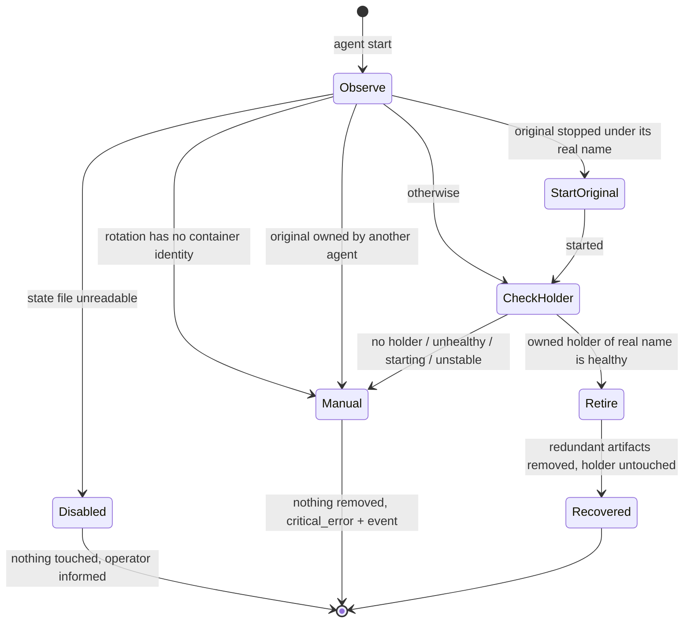

# M0-04 — Rotation recovery: current state machine, defects, and the safe design

## 1. Before this change (as audited, commit 07b42b3)

**Persisted state** (`<state dir>/rotations.json`, `StateTracker`): one record per `provider:secret:<comma-joined original IDs>` with `status` in `in_progress | completed | rollback_required | recovered | critical_error`, `original_container_id` (a comma-joined string), an always-empty `new_container_id`, and timestamps. It is written by `agent/trigger.go` around the whole `TriggerReload` call. The rolling/restart strategies in `internal/rotation` and `internal/watcher` do **not** journal their internal steps (create candidate, hand off proxy, rename, retire old).

**Transitions of the rolling strategy** (observable in Docker, not in the journal): original `app` → candidate `app_dso_new_<ts>` created → delivered/verified → proxy handoff → `app` renamed `app_dso_backup_<ts>` → candidate renamed `app` → backup removed. Restart strategy: original renamed `app_old_<ts>`, replacement created as `app`.

**Recovery**: at agent start, `RecoverFromCrash` (only for rotations older than five minutes) removed **every** owned container whose name matched an artifact pattern — in every service, not just the rotating one — *before* inspecting the original; then `CleanupOrphanedContainers` removed every owned artifact-named container again, unconditionally.

**Known unsafe transitions**
1. Crash between the two renames: nothing holds `app`; backup and candidate may each be the only running copy; both were deleted (S103).
2. Crash after a completed swap: backup deleted first, original then "missing" → reported critical although the service was fine (S102).
3. Multi-replica rotations stored `"id1,id2"` and recovery inspected that string as one ID.
4. The five-minute heuristic skipped recovery for a crash followed by a quick restart.
5. A corrupt state file was ignored (empty state) and the unconditional sweep still ran.
6. State was written with write+rename but no fsync.

## 2. Design now implemented

**Principle: Docker is authoritative, the journal is a hint.** A crash can land between a Docker action and its acknowledgement, so recovery decides only from what exists and what is verified healthy.

**Invariant:** an artifact (`<base>_dso_backup_*`, `<base>_dso_new_*`, `<base>_old_<digits>`) is removed only if (a) it is owned by this agent (`dso.owner`), (b) a *different* owned container holds the real name `<base>`, and (c) that holder is verified healthy: Docker HEALTHCHECK `healthy`, or — with no HEALTHCHECK — running for at least `minStableRunning` (30 s). The holder is re-verified and the artifact re-inspected (identity, ownership, name) immediately before each removal. Everything else is preserved and the rotation is marked `critical_error` with the list of preserved containers.

**State changes (back-compatible):** `original_container_ids` (structured list; the legacy string is still written and still read), `rotation_id`, `phase`; durable write (fsync file + directory); an unreadable state file is quarantined (`rotations.json.corrupt-<ts>`) and **disables all automatic action**; startup recovery considers every non-terminal rotation regardless of age.

### State diagram (observed state → decision)

### Decision matrix (each row is a test in `internal/agent/recovery_safety_test.go`)

| Situation | Action |
|---|---|
| Original healthy under real name; candidate left over | remove candidate only |
| Swap completed (promoted workload holds name healthy); old backup left | remove backup only |
| Crash between the two renames (no holder) | **remove nothing**, critical |
| Original gone, healthy holder, no artifact to name the service | remove nothing, critical (cannot prove which service) |
| Only original, stopped and renamed away | not started, remove nothing, critical |
| Original stopped under its real name | start it (rollback), then retire artifacts if healthy |
| Holder unhealthy / health still starting / no HEALTHCHECK and just started / stopped | preserve all, critical |
| Holder without HEALTHCHECK but stable ≥ 30 s | retire artifacts |
| Original owned by another agent / unowned | **no mutation at all**, critical |
| Foreign- or un-owned artifact names, look-alikes (`my_old_database`) | never touched |
| Multi-container rotation | each ID handled individually; unsafe ones preserved, others retired |
| Repeated recovery | idempotent; critical stays critical; nothing further removed |
| Unreadable state | **no action at all** (recovery and orphan sweep) |
| Docker unreachable | nothing removed |
| Startup orphan sweep | same rule as recovery (no blind delete) |

## 3. Transition journal (added after review)

Docker is authoritative for *what exists*; the journal is authoritative for *what was intended and how far it got*. Recovery reconciles both and preserves whatever it cannot account for.

**Mechanism (extends the existing `StateTracker`, no second controller; `internal/ledger` is not used).** `rotation.Journal` is implemented by `StateTracker.Record`, which upserts a record keyed by `rotation_id` and persists it durably (fsync file + directory) before returning. The trigger engine creates the record and passes the same ID to the strategies through the context; a manual rotation creates its own. Recorded: rotation ID, service ID, owner ID, strategy, original IDs, candidate IDs, opaque secret-version id (never a value), current transition, pending (unacknowledged) intent, expected and observed proxy target, committed flag, cleanup status, sequence number.

**Intent before action, acknowledgement after.** The rolling strategy records `intent_create_candidate`, then creates the candidate, then `candidate_created`; `candidate_ready` (started, delivered, verified); `intent_handoff` → handoff → `handoff_done`; `intent_swap` → renames → `swap_committed`; `intent_cleanup` → retire old → `completed`; `intent_rollback`/`rolled_back` on failure. **A failed INTENT write aborts before the guarded action** (fail closed; the agent also refuses rolling rotation outright when no journal is available). A failed acknowledgement is only logged: the intent is already durable and recovery treats an unacknowledged intent as "may have happened". Intent, Docker action, observation and acknowledgement are not one atomic transaction; the design never assumes they are.

**Candidate identity before its ID is known.** The candidate is created with the label `dso.rotation.id=<id>`, so a candidate whose container ID was never journalled (crash right after create) is still identified by an operation identity, not by its name.

**Journal-aware retirement** (on top of the name-holder + health rule):

| Artifact is | May be retired only if |
|---|---|
| the journalled ORIGINAL (previously active) | the healthy name holder is the journalled candidate (ID or rotation label) **and**, for a proxied rotation, there is durable evidence the handoff was committed (observed proxy target = holder, swap committed, or a swap/cleanup intent, which is written only after the handoff returned) |
| the journalled CANDIDATE | the healthy name holder is one of the journalled originals |
| no journal record, not proxy-managed | the name-holder rule alone |
| no journal record, proxy-managed (`dso.host_ports`) | **never** (routing evidence unavailable) |
| a missing original | it is explained only by a committed swap whose journalled candidate now holds the name healthy; otherwise critical |

**The reviewer's scenario** (candidate promoted to the real name while the proxy still points at the original) cannot arise in the rolling strategy as written, because the proxy handoff (`OnReady`) happens *before* the renames, and the proxy is in-process and rebuilt from running labelled containers after a restart. It is nevertheless covered by `TestRecoveryJournal_ProxiedRotationNeedsHandoffEvidenceBeforeRetiringTheOriginal` (handoff intent without evidence ⇒ both workloads preserved).

**Fault injection.** `RollingStrategy.FaultHook` (nil in production; set only by tests, it is a Go field, not an API) is called at named points; tests panic from it to model the process dying there. `internal/agent/crash_injection_test.go` runs the real strategy against a stateful fake daemon with the real tracker as journal, "restarts" by loading the journal from disk in a new tracker, runs the real recovery, and asserts per point: a healthy workload survives, unmanaged and foreign containers are untouched, exactly the permitted containers are removed, the rotation ends recovered or critical as expected, and repeated recovery changes nothing. Points: after_intent_create_candidate, after_candidate_create_before_ack, after_secret_delivery, after_start_before_verify, after_candidate_verified, after_intent_handoff, after_handoff_before_ack, after_intent_swap, between_renames, after_swap_before_commit_ack, after_swap_committed, after_intent_cleanup, after_cleanup_before_ack (the two handoff points exist only on the proxied path).

## 4. What is NOT done (honest limits)

* **Real process kill, real Docker, continuous traffic: UNVERIFIED.** The crash tests use a fake daemon in-process. The guarded real-daemon tests in `test/docker/recovery_test.go` build post-crash layouts but do not kill a DSO process mid-rotation, and no traffic is generated across a rotation. Prepared for the disposable VM, not run.
* **Restart strategy and signal rotation are not journalled yet** (only the rolling strategy is). Signal rotation's degraded state is in memory; restart-strategy recovery relies on the name-holder rule only.
* **No journalling of the proxy itself**: recovery cannot read the proxy's routing table (it is in-process and dies with the agent); it relies on the handoff evidence recorded in the journal.
* **Partial multi-file secret delivery** is reported precisely in-process (`SignalState`), but the persisted journal does not yet record per-file progress for signal rotation.
* Durability is process-crash safe, and intended power-loss safe where fsync is honoured; not a Docker+file transaction.
* The journal records no secret versions yet because providers do not expose a version identifier through the cache; the field exists for when they do.
