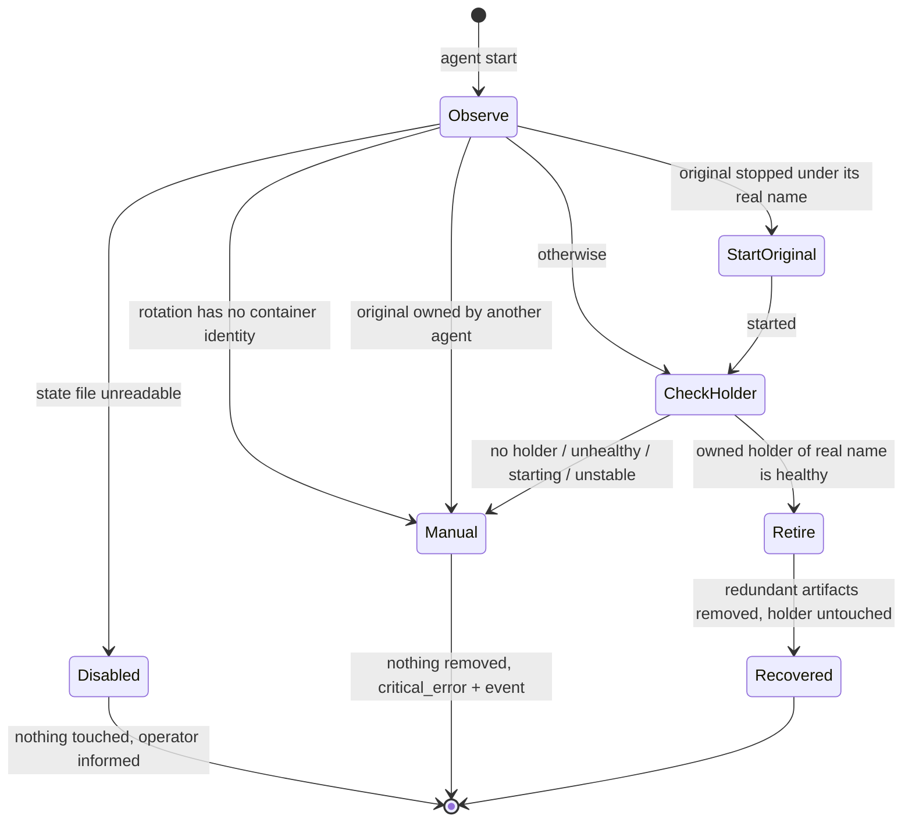

# M0-04 — Rotation recovery: current state machine, defects, and the safe design

## 1. Before this change (as audited, commit 07b42b3)

**Persisted state** (`<state dir>/rotations.json`, `StateTracker`): one record per `provider:secret:<comma-joined original IDs>` with `status` in `in_progress | completed | rollback_required | recovered | critical_error`, `original_container_id` (a comma-joined string), an always-empty `new_container_id`, and timestamps. It is written by `agent/trigger.go` around the whole `TriggerReload` call. The rolling/restart strategies in `internal/rotation` and `internal/watcher` do **not** journal their internal steps (create candidate, hand off proxy, rename, retire old).

**Transitions of the rolling strategy** (observable in Docker, not in the journal): original `app` → candidate `app_dso_new_<ts>` created → delivered/verified → proxy handoff → `app` renamed `app_dso_backup_<ts>` → candidate renamed `app` → backup removed. Restart strategy: original renamed `app_old_<ts>`, replacement created as `app`.

**Recovery**: at agent start, `RecoverFromCrash` (only for rotations older than five minutes) removed **every** owned container whose name matched an artifact pattern — in every service, not just the rotating one — *before* inspecting the original; then `CleanupOrphanedContainers` removed every owned artifact-named container again, unconditionally.

**Known unsafe transitions**
1. Crash between the two renames: nothing holds `app`; backup and candidate may each be the only running copy; both were deleted (S103).
2. Crash after a completed swap: backup deleted first, original then "missing" → reported critical although the service was fine (S102).
3. Multi-replica rotations stored `"id1,id2"` and recovery inspected that string as one ID.
4. The five-minute heuristic skipped recovery for a crash followed by a quick restart.
5. A corrupt state file was ignored (empty state) and the unconditional sweep still ran.
6. State was written with write+rename but no fsync.

## 2. Design now implemented

**Principle: Docker is authoritative, the journal is a hint.** A crash can land between a Docker action and its acknowledgement, so recovery decides only from what exists and what is verified healthy.

**Invariant:** an artifact (`<base>_dso_backup_*`, `<base>_dso_new_*`, `<base>_old_<digits>`) is removed only if (a) it is owned by this agent (`dso.owner`), (b) a *different* owned container holds the real name `<base>`, and (c) that holder is verified healthy: Docker HEALTHCHECK `healthy`, or — with no HEALTHCHECK — running for at least `minStableRunning` (30 s). The holder is re-verified and the artifact re-inspected (identity, ownership, name) immediately before each removal. Everything else is preserved and the rotation is marked `critical_error` with the list of preserved containers.

**State changes (back-compatible):** `original_container_ids` (structured list; the legacy string is still written and still read), `rotation_id`, `phase`; durable write (fsync file + directory); an unreadable state file is quarantined (`rotations.json.corrupt-<ts>`) and **disables all automatic action**; startup recovery considers every non-terminal rotation regardless of age.

### State diagram (observed state → decision)

### Decision matrix (each row is a test in `internal/agent/recovery_safety_test.go`)

| Situation | Action |
|---|---|
| Original healthy under real name; candidate left over | remove candidate only |
| Swap completed (promoted workload holds name healthy); old backup left | remove backup only |
| Crash between the two renames (no holder) | **remove nothing**, critical |
| Original gone, healthy holder, no artifact to name the service | remove nothing, critical (cannot prove which service) |
| Only original, stopped and renamed away | not started, remove nothing, critical |
| Original stopped under its real name | start it (rollback), then retire artifacts if healthy |
| Holder unhealthy / health still starting / no HEALTHCHECK and just started / stopped | preserve all, critical |
| Holder without HEALTHCHECK but stable ≥ 30 s | retire artifacts |
| Original owned by another agent / unowned | **no mutation at all**, critical |
| Foreign- or un-owned artifact names, look-alikes (`my_old_database`) | never touched |
| Multi-container rotation | each ID handled individually; unsafe ones preserved, others retired |
| Repeated recovery | idempotent; critical stays critical; nothing further removed |
| Unreadable state | **no action at all** (recovery and orphan sweep) |
| Docker unreachable | nothing removed |
| Startup orphan sweep | same rule as recovery (no blind delete) |

## 3. What is NOT done (honest limits)

* **No transition journal inside the strategies.** Phases such as `candidate_created`, `handoff_started`, `handoff_committed`, `cleanup_pending` are not persisted by `internal/rotation`/`watcher`; the record only says `rotation_requested`/`completed`. Recovery therefore cannot tell a *planned* from a *completed* handoff except by inspecting Docker, and it cannot know which backend the dead proxy pointed at (safe here because a healthy real-name holder always remains and the proxy is rebuilt from running labelled containers).
* **No fault-injection points / real process-kill tests.** The Docker tests in `test/docker/recovery_test.go` construct post-crash layouts and run the real recovery; they have not been run (no isolated daemon). Recovery after a real mid-rotation kill, with continuous traffic, is UNVERIFIED.
* **Durability** is process-crash safe and, with fsync, intended to be power-loss safe on honouring filesystems; it is not a transaction spanning Docker and the file.
* Rollback and cleanup *during* recovery are not themselves journalled; they are idempotent by construction (observe → act).
* The rolling strategy's own rollback paths (outside recovery) were not changed in this task.
