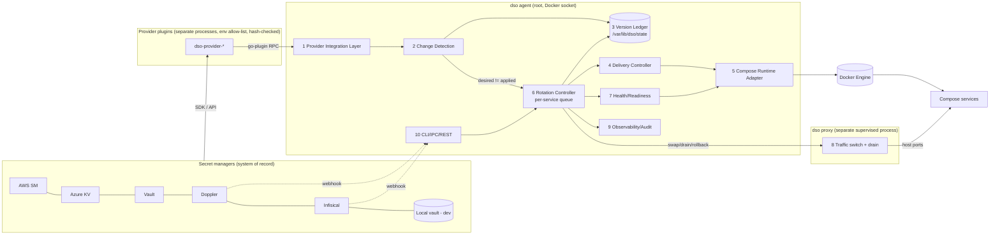

# Target Architecture

**Date:** 2026-11-07
**Direction:** ADR-001 (Option C identity, Option B surface). Findings referenced as `PE-xx` from `current-architecture-audit.md`.
**Rewrite needed?** **No.** Every component below maps onto an existing package. The work is to (1) add a persisted version ledger, (2) put rotation behind a per-service queue whose lock spans the whole operation, (3) widen the provider interface optionally, (4) separate the proxy's lifetime from the controller's, and (5) consolidate the two runtimes. Status: **proposed, needs owner approval.**

---

## 1. Component map (target → current code)

| # | Target component | Responsibility | Evolves from | Main change |
|---|---|---|---|---|
| 1 | **Provider Integration Layer** | Authenticate to providers, fetch values and version metadata, isolate provider code in plugin processes | `pkg/api/plugin.go`, `pkg/provider/*`, `internal/providers/store.go`, `cmd/plugins/*` | Optional `VersionedProvider` interface (ADR-005); per-call deadlines (PE-13); cache key = name **+ config hash**, no caller-supplied configs from IPC (PE-11); new Doppler/Infisical/GCP plugins |
| 2 | **Secret Version / Change Detection Engine** | Decide "is there something new to deliver?" | `TriggerEngine.StartPolling`, `ExecuteRotation` hash logic (`internal/agent/trigger.go:257-487`) | Compare provider version (or content hash fallback) against the **persisted applied-version ledger**, not an in-memory map (PE-03, PE-14) |
| 3 | **Version Ledger (state store)** | Durable record per (service, container, secret): desired version, applied version, last outcome | `internal/agent/state_tracker.go` (`/var/lib/dso/state`) | Extend the existing state file; one small JSON/bbolt file, not the central SQLite store |
| 4 | **Secret Delivery Controller** | Turn a desired version into a delivery plan per service (env vs file, strategy) | Env/file assembly duplicated in `controller.go:920-983`, `:1243+`, `:847-876` | Single `DeliveryPlan` builder used by every strategy |
| 5 | **Docker Compose Runtime Adapter** | All Docker API calls; Compose label semantics; container clone | `internal/rotation/container_clone.go`, Docker calls in `watcher/controller.go`, `internal/injector` | Compose-aware clone (labels/config-hash policy), post-start exec delivery into tmpfs (PE-08), eligibility checks (PE-05/06) |
| 6 | **Container Rotation Controller** | Per-service serialized queue; strategy execution; coalescing of pending changes | `ReloaderController.TriggerReload` + `RollingStrategy.Execute` + `LockManager` | Lock held until outcome is final (PE-02); pending change re-queued, never dropped (PE-01); no stale-lock reclaim while holder alive (PE-23) |
| 7 | **Health / Readiness Validator** | Decide "new container is ready" | `internal/rotation/health_check.go`, `health_verifier.go` | Add optional `dso.readiness` label: `tcp:PORT`, `http:PORT/PATH`, `exec:CMD`; refuse "zero-downtime" without one (PE-09) |
| 8 | **Traffic Switching & Rollback Controller** | Move host-port traffic; drain; roll back | `internal/proxy/*`, `OnReady` hook (`controller.go:1018-1070`) | Proxy runs as a **separate supervised process** (`dso proxy`), controlled over a local socket, so controller restarts don't drop traffic (PE-10, ADR-006) |
| 9 | **Observability / Audit Layer** | Metrics, events, runtime audit, readiness endpoint | `pkg/observability`, `internal/audit`, `internal/notify`, `internal/server` event stream | `/readyz` reflecting provider/Docker/ledger state (PE-26); rotation audit records include version ids |
| 10 | **CLI / Config Interface** | `dso.yaml`, labels, CLI, REST | `internal/cli`, `pkg/config`, `internal/server` | `dso rotation plan`, `dso rotation status`, `dso rotate <secret>`; config schema adds `readiness` and provider `version_source` (additive only) |

Explicitly **outside** the target: `dso central` (frozen, ADR-002), RBAC, multi-host, Kubernetes.

## 2. Diagram



## 3. Data flow (steady state)

1. Change Detection asks each provider for **version metadata** (`GetSecretVersion`) on a jittered interval; falls back to full fetch + SHA-256 when the provider does not implement it. Webhooks (DSO HMAC webhook, or Doppler/Infisical webhook adapters) short-circuit the wait.
2. If `provider_version != ledger.desired_version`, it fetches the value once (with deadline), stores it in the memory cache, writes `desired_version` to the ledger, and enqueues `RotationRequest{secret, version}` for every service that references the secret.
3. Rotation Controller keeps **one queue per Compose service**. A new request for a service with an in-flight rotation **replaces** any queued one (coalescing), never disappears.
4. On completion, the ledger records `applied_version` + outcome per container; `RotationSucceeded` is emitted only when at least one container actually reached the new version.
5. On agent start, the engine compares provider version with `applied_version` — **equal ⇒ no action** (fixes PE-03).

## 4. Rotation lifecycle (state machine)

```
            ┌────────────┐ eligibility fails (stateful+rolling, host port w/o proxy,
 enqueue ─▶ │  PLANNED   │──── no readiness for zero-downtime) ──▶ BLOCKED (operator action / restart window)
            └─────┬──────┘
                  │ acquire service lock (held until terminal state)
            ┌─────▼──────┐
            │ PREPARING  │ fetch value (deadline), build DeliveryPlan, write ledger "in_progress"
            └─────┬──────┘
            ┌─────▼──────┐   create/start fails ─────────────────────────┐
            │ STARTING   │ create shadow, start, deliver file secrets     │
            └─────┬──────┘ post-start via exec into tmpfs (PE-08)       │
            ┌─────▼──────┐   unhealthy/timeout ──────────────────────────┤
            │ VERIFYING  │ HEALTHCHECK + readiness probe + file probe     │
            └─────┬──────┘                                              │
            ┌─────▼──────┐   handoff fails ─────────────────────────────┤
            │ SWITCHING  │ proxy SwapBackend (if port-owned)              │
            └─────┬──────┘                                              ▼
            ┌─────▼──────┐  rename/verify fails → restore names     ┌──────────┐
            │ COMMITTING │────────────────────────────────────────▶ │ROLLED_BACK│ old keeps serving,
            └─────┬──────┘                                          └──────────┘ ledger: applied=old,
            ┌─────▼──────┐                                          service marked degraded
            │ DRAINING   │ drain window, stop/remove old (retry)
            └─────┬──────┘
            ┌─────▼──────┐
            │ SUCCEEDED  │ ledger applied=new; event; release lock; run coalesced next request
            └────────────┘
 Any state + agent crash ⇒ on start: recovery reads ledger "in_progress" + Docker names/labels,
 restores original, removes shadow, re-enqueues (existing internal/agent/recovery.go extended).
```

`restart` strategy follows PLANNED → PREPARING → (stop, recreate) → VERIFYING → SUCCEEDED/FAILED, with the honest label "downtime expected" in `rotation plan`.

## 5. Failure handling

| Failure | Behaviour | Code to change |
|---|---|---|
| Provider timeout / auth error / empty payload | No enqueue; provider marked unhealthy; `/readyz` degraded; existing containers untouched (P-03 behaviour kept) | add deadline in `trigger.go:449-453` |
| Provider returns new version but value fetch fails | Ledger `desired` not advanced; retry with backoff | same |
| Lock busy | Request stays queued (coalesced); no hash advance; no success event | `trigger.go:284`, `:338-343`; `controller.go:808-816` |
| Shadow unhealthy | Discard shadow; old keeps serving; ledger records failure + reason; **no automatic fallback to `restart`** unless policy `on_rolling_failure: restart` is set explicitly | `controller.go:1153-1163` |
| Agent crash mid-rotation | Proxy process keeps serving the old backend; on restart, recovery uses ledger + Docker state | `internal/agent/recovery.go` |
| Docker daemon outage | Queue paused; `/readyz` not ready; no partial actions started | `controller.go` event loop |
| Proxy process crash | Supervisor restarts it; it rebuilds listeners from its own persisted table; controller refuses new SWITCHING until proxy healthy | new `dso proxy` |

## 6. Auth flows

- **Agent → provider:** plugin-native, prefer workload identity: AWS default chain/IAM role; Azure `DefaultAzureCredential`; Vault **AppRole/JWT/Kubernetes with token renewal** (new, PE-15); Doppler service token or service-account OIDC; Infisical machine identity (universal-auth or cloud-native). Credentials come from `dso.yaml` (root:dso 0640) or env/files referenced by it; never from IPC callers.
- **CLI → agent (IPC):** `SO_PEERCRED` as today. New authorization tiers (ADR-007): `read-status` (dso group), `trigger-rotation` (dso group, audited), `read-secret-value` (root or an explicitly listed group per project), `admin` (root: provider connectivity checks, reload config).
- **External → agent:** HMAC webhook (kept), provider webhook adapters verify the vendor's own signature scheme.
- **Browser → WebUI:** unchanged (session cookie, origin check).

## 7. Provider integration flow

```
Init(config)                        // unchanged
GetSecretWithContext(ctx, name)      // existing optional interface; ctx now always has a deadline
GetSecretVersion(ctx, name) (VersionInfo, error)   // NEW optional interface
```

## 8. Key interfaces and structs (proposed, additive)

```go
// pkg/api (new optional interface; old plugins keep working)
type VersionInfo struct {
    VersionID string    // provider-native id (AWS VersionId, Vault KV v2 version, Azure version, Doppler/Infisical version); "" if unknown
    UpdatedAt time.Time // zero if unknown
}
type VersionedProvider interface {
    GetSecretVersion(ctx context.Context, name string) (VersionInfo, error)
}

// internal/agent (ledger, extends StateTracker's file)
type AppliedRecord struct {
    Service, ContainerID, Secret string
    DesiredVersion, AppliedVersion string // VersionID or "sha256:<hex>" fallback; never the value
    Outcome  string // succeeded | rolled_back | blocked | failed
    Reason   string
    At       time.Time
}

// internal/rotation
type RotationRequest struct {
    Service  string
    Secret   string
    Version  string
    Reason   string // poll | webhook | manual | startup-drift
}
type Eligibility struct {
    Strategy        string // rolling | restart | signal
    ZeroDowntime    bool
    Blockers        []string // "stateful volume /var/lib/mysql", "host port 8080 not proxy-owned", "no readiness probe"
}
func Assess(inspect container.InspectResponse, labels map[string]string, proxyOwned bool) Eligibility
```

`Assess` generalises `internal/analyzer` + `internal/strategy/decision_engine.go` and is applied to **explicit** strategies too (PE-05).

## 9. Security boundaries

```
[ provider APIs ] ← TLS, workload identity →  [ plugin process: allow-listed env, no Docker socket ]
        ↑ go-plugin RPC (stdio/local)                                 
[ dso agent: root, Docker socket, memory-only values, ledger without values ]
   ├─ IPC socket 0660 root:dso, SO_PEERCRED, tiered authz (ADR-007)
   ├─ REST 127.0.0.1, token required for non-loopback
   └─ control socket → [ dso proxy: no Docker socket, no secret values, only backends ]
[ containers: env (visible to docker inspect) or tmpfs files 0400 ]
```

The proxy split *reduces* privilege: the proxy needs neither secrets nor the Docker socket.

## 10. Can the current code evolve into this?

Yes, incrementally:

| Step | Size (rough, single maintainer) | Why that size |
|---|---|---|
| Ledger + startup no-op (PE-03, PE-14 fallback by hash) | 1–1.5 weeks | Extends `state_tracker.go`; touches `ExecuteRotation`; needs crash tests |
| Per-service queue + lock spanning async work (PE-01, PE-02, PE-23) | 1.5–2 weeks | Restructures `TriggerReload` dispatch; high test burden (race, coalescing) |
| Eligibility assessment + `rotation plan` (PE-04/05/06) | 1 week | Mostly existing analyzer logic, new CLI |
| Post-start tmpfs delivery for rotation path (PE-08) | 1 week | Reuse `injector.InjectFiles`; integration tests with tmpfs |
| Readiness probes (PE-09) | 1 week | Label parsing + three probe kinds |
| `VersionedProvider` + AWS/Vault/Azure implementations | 1.5 weeks | Additive interface; per-plugin work |
| Doppler + Infisical plugins | 1–1.5 weeks each | New SDK/API clients, auth, tests with recorded fixtures |
| Proxy as separate process (PE-10) | 2–3 weeks | New supervision, control protocol, state persistence; riskiest item |
| Runtime consolidation (PE-18) | 2 weeks | Local mode moves onto the agent path |

Estimates assume one experienced maintainer, include tests and docs, and exclude review latency. They are effort reasoning, not calendar commitments.
